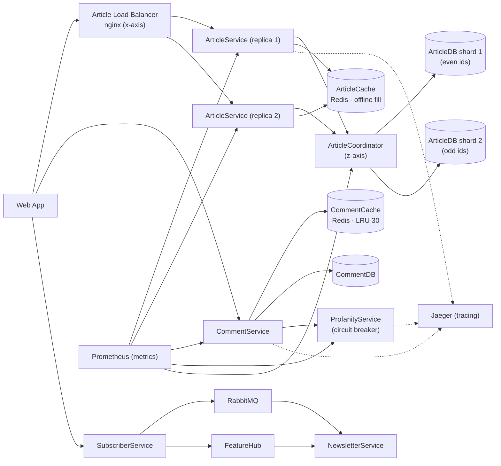

# HappyHeadlines — a scaled, fault-isolated, observable news platform

DLS Compulsory Assignments #1 (W40) and #2 (W46). CA#1 fixed HappyHeadlines'
availability with cache layers; CA#2 scales it (x- and z-axis), isolates
failures, makes it observable, and applies green-software (GAF) tactics.

**Stack:** C# / .NET 9 (ASP.NET Core minimal APIs + a console worker), Redis
(StackExchange.Redis), PostgreSQL (Npgsql), RabbitMQ, FeatureHub, OpenTelemetry.

## Architecture (C4 level 2)



The full text-based C4 model — context, container (level 2) and the
ArticleService component view (level 3) — is in
[`docs/architecture.dsl`](docs/architecture.dsl) (open in Structurizr Lite).

## The scale cube

- **x-axis (horizontal duplication).** `ArticleService` runs as two identical
  replicas behind an nginx load balancer (`deploy/nginx.conf`, port 4000).
  nginx round-robins between them; the LB is the only entry point.
- **z-axis (data partitioning).** The article database is sharded by article id
  across two PostgreSQL shards (`article-db-1` even ids, `article-db-2` odd
  ids). The `ArticleCoordinator` (`src/ArticleCoordinator/Program.cs`) is the
  coordination component: `GET /route/{id}` returns the shard that owns an
  article, so the service never hard-codes the topology.

## Fault isolation

`CommentService` moderates new comments via the `ProfanityService` over HTTP,
behind a hand-rolled circuit breaker (`src/CommentService/CircuitBreaker.cs`).
When the ProfanityService is down, the breaker opens after 3 failures and the
CommentService degrades gracefully (accepts the comment unmoderated). The two
services live in separate swimlanes — only the HTTP call couples them.

## Monitoring (metrics, logging, distributed tracing)

- **Tracing** — OpenTelemetry in ArticleService, ArticleCoordinator,
  CommentService and ProfanityService, exported OTLP to **Jaeger**
  (http://localhost:16686).
- **Metrics** — each service exposes a hand-rolled `/metrics` endpoint
  (Prometheus text format: request counts, cache hits/misses, circuit-breaker
  state); **Prometheus** (http://localhost:9090) scrapes them.
- **Logging** — structured JSON lines with the trace id, e.g.
  `{"service":"comment-service","traceId":"…","method":"POST","path":"/articles/1/comments","status":200,"durationMs":12}`.

## DevOps

- **CI/CD** — `.github/workflows/ci-cd.yml` builds every service and publishes
  the image to GHCR (tagged `latest` + git commit SHA) on push to `main`.
- **Release toggle** — the whole SubscriberService is behind the FeatureHub
  boolean flag `SubscriberService`. The SubscriberService refuses requests when
  it is OFF, and the **NewsletterService reads the same flag** and skips sending
  (acknowledging queued events) when it is OFF — see
  `src/NewsletterService/Program.cs`.

## Sustainability (GAF tactics)

Three tactics, each a real code change — see [`docs/sustainability.md`](docs/sustainability.md):

1. **Compression** — gzip responses on ArticleService + CommentService.
2. **Write-if-changed** — `article-fill` skips Redis writes when nothing changed.
3. **Response caching** — `Cache-Control: max-age=60` on article reads.

## Topology (Docker Compose)

| Container | Role |
|---|---|
| `article-db-1`, `article-db-2` | article DB shards (z-axis: even/odd ids) |
| `comment-db`, `subscriber-db` | comment + subscriber databases |
| `article-cache`, `comment-cache` | the two Redis cache layers |
| `article-service`, `article-service-2` | ArticleService replicas (x-axis) |
| `article-lb` | nginx load balancer in front of the replicas (:4000) |
| `article-coordinator` | z-axis shard router (:4007) |
| `article-fill` | offline 14-day cache fill |
| `comment-service`, `profanity-service` | comments + profanity moderation (:4002/:4006) |
| `subscriber-service`, `newsletter-service` | subscriber swimlanes (:4004/:4005) |
| `rabbitmq`, `featurehub` | message queue + release-toggle backend |
| `jaeger`, `prometheus` | tracing + metrics (:16686/:9090) |
| `dashboard` | cache hit-ratio page (:4003) |

## Running it

```bash
docker compose up --build
```

Before the subscriber demo, create the `SubscriberService` boolean feature in the
FeatureHub admin console (http://localhost:8090) and set the API key in
`docker-compose.yml` if needed.

### Cache layers (CA#1)

```bash
curl localhost:4001/cache/size            # articles cached by the offline fill
curl localhost:4001/articles/1            # recent  -> "source":"cache"
curl localhost:4001/articles/12           # old     -> "source":"db" (outside 14 days)
curl localhost:4002/articles/1/comments   # first = "db", second = "cache"
```

### Scale cube

```bash
curl localhost:4007/route/1               # odd id  -> shard 2
curl localhost:4007/route/2               # even id -> shard 1
curl localhost:4000/articles/1            # via the load balancer (x-axis)
curl localhost:4001/health                # replica 1
curl localhost:4008/health                # replica 2
```

### Fault isolation

```bash
curl -X POST localhost:4002/articles/1/comments -H 'Content-Type: application/json' \
  -d '{"author":"Ben","content":"This is a great article"}'
# -> "moderated": true

curl -X POST localhost:4002/articles/1/comments -H 'Content-Type: application/json' \
  -d '{"author":"Ben","content":"This is damn good"}'
# -> 400 "comment rejected: contains profanity"

# docker compose stop profanity-service, post a few comments, then:
curl localhost:4002/circuit               # -> "breaker": "open"
```

### Monitoring

```bash
curl localhost:4001/metrics               # Prometheus text metrics
# Jaeger UI: http://localhost:16686  · Prometheus: http://localhost:9090
```

See [`docs/CA2-submission.md`](docs/CA2-submission.md) for the full
submit-what-where guide.
