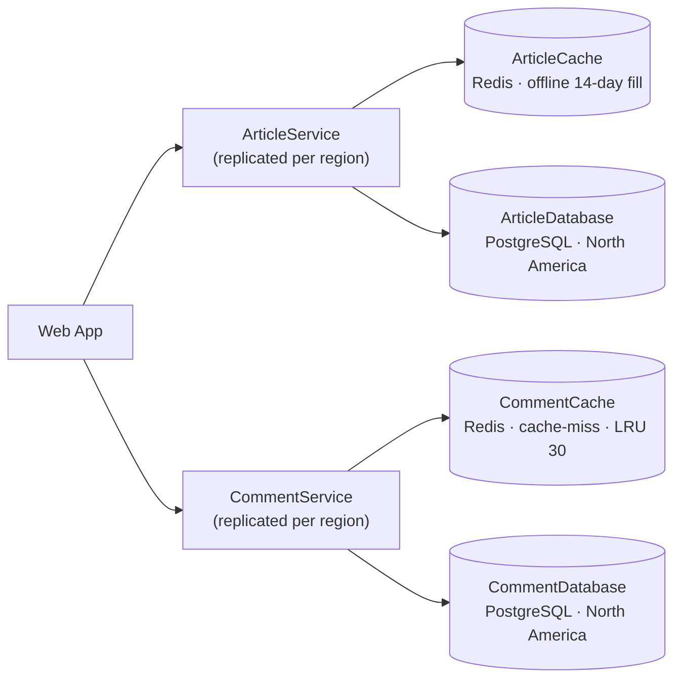

# HappyHeadlines — Cache Layers

DLS Compulsory Assignment #1 (W40): fix HappyHeadlines' availability and
latency by putting cache layers between the region-replicated services and the
distant global databases.

All three deliverables are implemented and runnable (see [Running it](#running-it)):
both cache layers **and** the cache hit-ratio dashboard.

## Stack

C# / .NET 9 — the services are ASP.NET Core minimal APIs and the offline fill is
a .NET console worker. Redis via **StackExchange.Redis**, PostgreSQL via
**Npgsql**, deployed with Docker Compose.

## The problem

The `ArticleService` and `CommentService` are already replicated to each
region, but they all talk to a single global database instance sitting in
North America. European users see slow responses; some articles become
unavailable. Replicating the database (an x-axis split) was rejected on cost,
so the ARB approved **cache layers** in front of each database instead.

## Architecture (C4)



- **ArticleCache** — an **offline** process (`article-fill`) periodically copies
  the latest 14 days of articles into Redis. The service only reads the cache
  and falls back to the database for older articles.
- **CommentCache** — a **cache-miss** strategy: on a miss the service reads the
  database and stores the comments, tracking the most-recently-accessed
  articles in a sorted set. When more than 30 articles are cached, the
  least-recently-used is evicted.

The full text-based C4 model (context + container levels) is in
[`docs/architecture.dsl`](docs/architecture.dsl) — open it with Structurizr
Lite (`structurizr/lite` on port 8080) to browse it interactively.

## Topology (Docker Compose)

| Container | Image | Role |
|---|---|---|
| `article-db`, `comment-db` | `postgres:16-alpine` | global databases (North America), seeded via `db/init-*.sql` |
| `article-cache`, `comment-cache` | `redis:7-alpine` | the two cache layers |
| `article-service`, `comment-service` | custom .NET (ASP.NET Core) | region services (read-through / cache-miss) |
| `article-fill` | custom .NET (console worker) | the offline 14-day fill process |
| `dashboard` | custom (nginx + static) | the cache hit-ratio dashboard (http://localhost:4003) |

## Running it

```bash
docker compose up --build
```

Then exercise the two strategies:

```bash
# ArticleCache (offline fill)
curl localhost:4001/cache/size            # how many articles the fill cached
curl localhost:4001/articles/1            # recent  -> "source":"cache"
curl localhost:4001/articles/12           # old     -> "source":"db"  (outside 14 days)

# CommentCache (cache-miss + LRU)
curl localhost:4002/articles/1/comments   # first request  -> "source":"db"
curl localhost:4002/articles/1/comments   # second request -> "source":"cache"
curl localhost:4002/cache/stats           # cached articles vs the 30-article cap

# Hit-ratio (drives the dashboard)
curl localhost:4001/cache/hit-ratio       # article cache hits/misses/total/ratio
curl localhost:4002/cache/hit-ratio       # comment cache hits/misses/total/ratio
```

## Dashboard

Open **http://localhost:4003** for the cache hit-ratio dashboard — a small
auto-refreshing page showing hits, misses and hit ratio for both caches.

## CI/CD

A GitHub Actions pipeline (`.github/workflows/ci-cd.yml`) builds every service
and publishes the images to the **GitHub Container Registry** on every push to
`main`.

- **Trigger:** push to `main`
- **Services:** `article-service`, `comment-service`, `dashboard`
- **Registry:** `ghcr.io/benjamindamc/<service>`
- **Versioning:** each image is tagged `latest` (rolling) *and* with the exact
  git commit SHA, so every build is uniquely versioned and any release can be
  redeployed verbatim.

Pull and run a released image directly:

```bash
docker run -p 4001:4001 ghcr.io/benjamindamc/article-service:latest
```

## W44 — Newsletter & Subscriber services (fault isolation + release toggle)

On top of the cache layers, this adds a **SubscriberService** and a
**NewsletterService** in two separate swimlanes, decoupled by **RabbitMQ** and
each with its own data, so a failure in one cannot take down the other.

```
Web ──> SubscriberService ──(RabbitMQ)──> NewsletterService
             │   release toggle (FeatureHub)
             ▼
        subscriber-db (PostgreSQL)
```

- **SubscriberService** (`:4004`) — owns the subscriber database; exposes
  `GET/POST /subscribers` and `DELETE /subscribers/{email}`; publishes
  `subscriber.created / updated / deleted` events to RabbitMQ.
- **NewsletterService** (`:4005`) — consumes those events from the queue and
  "sends" the corresponding email (logs it). It shares **no database** with the
  subscriber service.
- **RabbitMQ** (`rabbitmq:3-management`, AMQP `:5672`, UI `:15672`) — the queue
  that isolates the two swimlanes.
- **FeatureHub** (`:8087` edge) — the release-toggle backend.

### Release toggle (FeatureHub)

The whole `SubscriberService` is hidden behind a boolean FeatureHub flag
**`SubscriberService`**. When it is OFF every endpoint returns `503`; when ON the
service works normally. Because the toggle lives in FeatureHub, you can roll the
feature out/in **without redeploying** — and you can go further and gate
individual endpoints (a "partial" rollout) by adding more flags.

```bash
# toggle is OFF -> 503
curl -i localhost:4004/subscribers

# flip "SubscriberService" ON in the FeatureHub admin console, then:
curl localhost:4004/subscribers
```

Before running, set the FeatureHub server-evaluated API key in
`docker-compose.yml` (`FEATUREHUB_API_KEY`), create the `SubscriberService`
boolean feature, and toggle it. If FeatureHub is unreachable the service fails
**closed** (disabled).

### Try the fault isolation

```bash
docker compose up --build
curl -X POST localhost:4004/subscribers -H 'Content-Type: application/json' -d '{"email":"a@b.dk"}'
# -> NewsletterService logs "welcome email -> a@b.dk" (via RabbitMQ)
```

Stop the `newsletter-service` container, post another subscriber, then restart
it — the event is still delivered from the queue (isolation works both ways).

## Scope

**Done:** C4 model, Docker Compose topology, both cache layers (offline 14-day
fill + cache-miss LRU), the cache hit-ratio dashboard, and the W44
subscriber/newsletter services with RabbitMQ fault isolation and a FeatureHub
release toggle.
